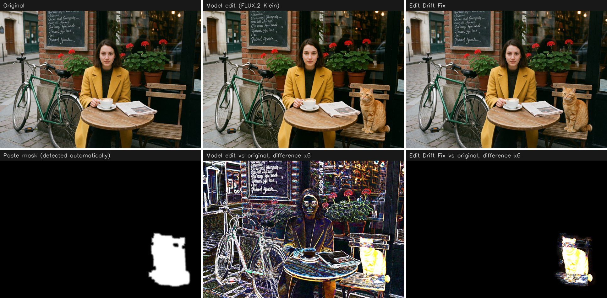
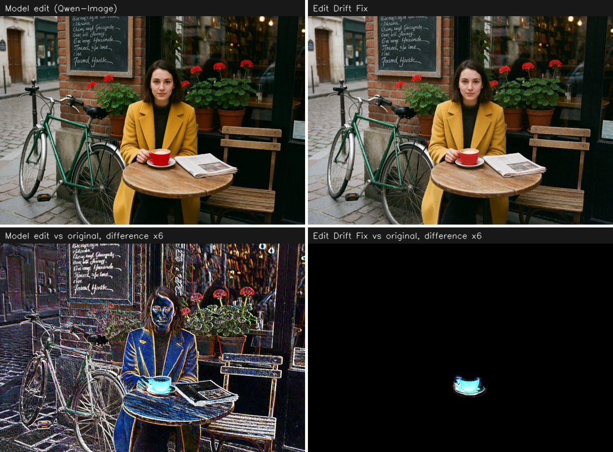
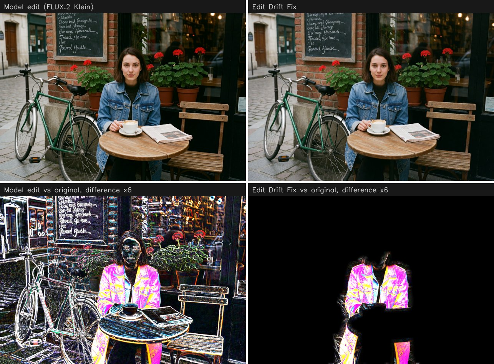

# ComfyUI-EditDriftFix

Helps you work with generative AI without introducing unwanted changes to the original image.

Editing models (Qwen-Image-Edit, FLUX Kontext, FLUX.2 Klein, GPT-Image, Nano Banana) return a whole new picture. Even when you ask for one small change, the frame comes back slightly zoomed and shifted, the colours move, and fine detail everywhere is re-rendered. **Edit Drift Fix** takes the original and the edit, and returns the original with only the real change pasted in.



The bottom row shows the difference from the original, amplified 6×. The raw model output differs everywhere; after Edit Drift Fix only the cat does.

## What it does

1. **Aligns geometry** — size, fractional zoom and shift, with a single resampling of the edit.
2. **Restores colour** — the colour and brightness shift is measured on unchanged background only.
3. **Finds the changed area** — the threshold adapts to the noise of the pair, so no manual mask is needed.
4. **Composites** — inward feather, Laplacian-pyramid blending, grain matching.
5. **Protects the rest** — outside the mask the output is the original, bit for bit.

It works on image pairs only: no latents, no sampler, no extra models. A 2 MP pair takes about a second on a GPU.

## Install

**ComfyUI Manager:** search for `Edit Drift Fix`.

**Manual:**

```bash
cd ComfyUI/custom_nodes
git clone https://github.com/YOUR_GITHUB_USERNAME/ComfyUI-EditDriftFix
pip install -r ComfyUI-EditDriftFix/requirements.txt
```

The only dependency besides ComfyUI itself is OpenCV.

## Quick start

1. Add **Edit Drift Fix** (`image/Edit Drift Fix`).
2. Connect the original to `source` and the model output to `edited`.
3. Pick a preset and run.

A ready graph is in [`example_workflows/edit_drift_fix_basic.json`](example_workflows/edit_drift_fix_basic.json).

| Preset | Use it for |
|---|---|
| `spot_edit` | a small fix: a detail, lettering, a blemish |
| `object_edit` | an object replaced, added or removed; leaves room for shadows and reflections |
| `large_soft_edit` | a large soft change: lighting, background, clothes |
| `full_image` | the whole frame changed (style, relight): geometry is aligned, nothing is pasted |
| `custom` | your own values |

Picking a preset fills the fields of the node. Changing any field by hand switches the preset to `custom`.

## More examples

**Recolour a small object** (Qwen-Image, `spot_edit`) — the mask covers 1% of the frame:



**Change clothes** (FLUX.2 Klein, `object_edit`) — the model zoomed in by 2%; the result is back in register:



## Settings

| Field | Meaning |
|---|---|
| `mask_mode` | where the paste area comes from, see [Masks](#masks) |
| `sensitivity` | higher — weaker differences (shadows, highlights) enter the mask |
| `minor_filter` | drops weak side changes, such as background text or foliage the model repainted along the way. `0` keeps everything, `1` keeps only the main edit |
| `mask_expand` | safety margin around the detected edit, % of the diagonal |
| `feather` | width of the soft transition, % of the diagonal; built inwards |
| `color_fix` | `off`, `global`, or `global_plus_local` |
| `grain_match` | adds the missing grain of the original to the pasted area; `0` is off |

Advanced settings live in a separate **Edit Drift Fix Options** node, connected to `options`: motion model, shift limit, blend mode, colour strength, what to do with a global edit, and `edit_opacity` — how much of the edit is mixed in inside the mask, for when the model overdid the change.

### Masks

Connect a mask to `edit_mask` and choose how it is used:

| `mask_mode` | Behaviour | Typical use |
|---|---|---|
| `auto` | detect changes automatically | the default |
| `auto_inside_mask` | detect, but only inside your mask | the model also touched a face or text elsewhere |
| `auto_plus_mask` | detected changes plus your mask | detection missed a faint shadow or reflection |
| `mask_only` | exactly your mask | you already have the inpaint mask |
| `whole_image` | no paste, return the aligned edit | style transfer, relighting |

If the automatic mask covers more than 40% of the frame, the edit is treated as global: the node returns the aligned edit and says so in the report.

### Outputs

| Output | Content |
|---|---|
| `image` | the result, at the size of the original |
| `mask` | the soft paste mask |
| `aligned_edited` | the edit, aligned and colour-corrected, not composited |
| `report` | JSON with the measurements |

After a run the node shows a one-line summary: motion model, drift in pixels, mask area, confidence. The report adds the residual shift on the background, the colour difference before and after correction, the number of dropped side regions, and warnings — for example, when the mask looks too tight.

## Other nodes

| Node | Purpose |
|---|---|
| Edit Drift Align | alignment only; also returns the validity mask and the transform |
| Edit Drift Color | colour correction only |
| Edit Drift Mask | change mask only |
| Edit Drift Composite | compositing with a mask you supply |
| Edit Drift Pad / Unpad | before generation, pad the image to the model grid (8/16/32/64) instead of letting the model resize it; afterwards, crop the padding |

## License

MIT. Created by @einhorn13 . Design references are listed in [NOTICE](NOTICE).
